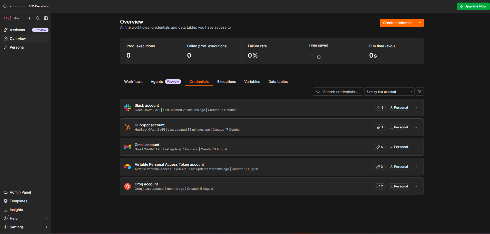
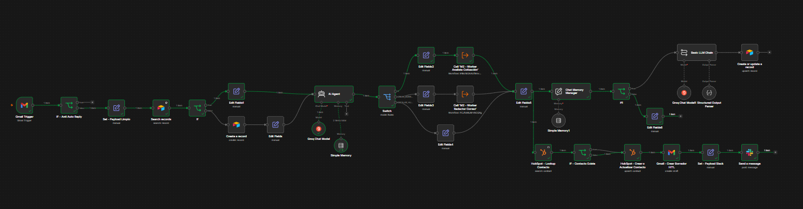

# Proyecto Integrador - Agentes IA en n8n

**Alumno:** Federico Jorda  
**Checkpoint actual:** Módulo 4 - Integraciones Avanzadas e Interconexión de Sistemas

Este repositorio contiene la evolución del Proyecto Integrador desarrollado en n8n. El Checkpoint 4 parte del workflow del Módulo 3 y suma integraciones reales con Gmail, HubSpot y Slack, manteniendo la memoria persistente en Airtable y la arquitectura multi-agente.

## Archivos principales

- `checkpoint1_federico_jorda.json`: checkpoint inicial del proyecto.
- `checkpoint4_federico_jorda.json`: workflow final del Checkpoint 4.
- `docs/credentials.png`: evidencia de las credenciales configuradas en n8n.
- `docs/workflow-ejecucion.png`: evidencia de una ejecución exitosa del workflow.

## Arquitectura del Checkpoint 4

```text
Gmail Trigger
  |
  v
IF - Anti Auto Reply
  | false
  v
Set - Payload Limpio
  |
  v
IF - Email Valido
  | true
  v
Airtable - Search Records
  |
  v
IF - Usuario existente
  |-----------------------|
  | true                  | false
  v                       v
Contexto existente     Crear memoria
  |                       |
  |-----------------------|
          |
          v
      AI Agent
          |
          v
        Switch
  |---------|---------|
  v         v         v
Analista  Redactor  Escalar humano
  |         |         |
  |---------|---------|
          |
          v
    Salida unificada
      |           |
      |           +--> HubSpot - Lookup Contacto
      |                    |
      |                    v
      |              IF - Contacto Existe
      |               |             |
      |             true           false
      |               |             |
      |               |             v
      |               |    HubSpot - Crear o Actualizar Contacto
      |               |             |
      |               |-------------|
      |                     |
      |                     v
      |          Gmail - Crear Borrador HITL
      |                     |
      |                     v
      |          Set - Payload Slack
      |                     |
      |                     v
      |          Slack - #operaciones
      |
      v
Chat Memory Manager
  |
  v
IF - Más de 5 intercambios
  | true
  v
Basic LLM Chain + Structured Output Parser
  |
  v
Airtable - Create or Update
```

## Controles preventivos evaluados

### 1. IF anti auto-reply

El nodo `IF - Anti Auto Reply` está inmediatamente después del Gmail Trigger.

La condición detecta:

- `Auto-reply`
- `Auto reply`
- `Out of office`
- `Undeliverable`
- remitentes `no-reply@`
- remitentes `noreply@`

Condición utilizada:

```javascript
{{
  /auto[- ]?reply|out of office|undeliverable/i.test($json.Subject || '') ||
  /no-?reply@/i.test($json.From || '')
}}
```

Si la condición devuelve TRUE, la rama queda sin continuación y el mensaje automático no entra al resto del workflow.

### 2. Limpieza y validación del payload

`Set - Payload Limpio` conserva únicamente la información necesaria del correo entrante:

```json
{
  "from": "remitente",
  "subject": "asunto",
  "body_text": "texto",
  "email": "correo",
  "session_id": "correo",
  "user_message": "contenido de la solicitud"
}
```

No se arrastran adjuntos, binarios, HTML completo, labels ni metadata innecesaria.

Después de este Set se ejecuta `IF - Email Valido`:

```text
{{ $json.email }} is not empty
```

Solo la rama TRUE continúa. De esta manera se evita propagar un payload sin email válido hacia CRM y otros conectores.

### 3. Lookup previo y control anti-duplicados en HubSpot

Antes de cualquier escritura se ejecuta:

```text
HubSpot - Lookup Contacto
```

La búsqueda se realiza por email y con límite 1.

Luego, `IF - Contacto Existe` comprueba:

```text
{{ $json.id }} is not empty
```

La lógica final es:

```text
Si existe:
IF TRUE -> Gmail - Crear Borrador HITL

Si no existe:
IF FALSE -> HubSpot - Crear o Actualizar Contacto -> Gmail - Crear Borrador HITL
```

Así se evita ejecutar nuevamente una escritura de contacto cuando el registro ya existe y se reduce el riesgo de duplicados / Error 409.

### 4. Human-in-the-loop con Gmail Draft

La salida de correo está configurada exclusivamente como:

```text
Resource: Draft
Operation: Create
```

El agente crea el borrador pero no envía el correo automáticamente.

La revisión y el envío final quedan bajo control humano.

### 5. Payload mínimo antes de Slack

Antes del nodo Slack se utiliza:

```text
Set - Payload Slack
```

Ese Set deja únicamente los campos necesarios para la notificación:

- `channel_message`
- `customer_email`
- `subject`

Slack no recibe adjuntos, binarios ni el payload completo de Gmail.

## Integraciones externas

### Gmail

- Entrada: Gmail Trigger.
- Evento: Message Received.
- Salida: Draft - Create.
- Autenticación: OAuth2.
- Guardrail: no se utiliza Send para la respuesta generada.

### HubSpot

- Recurso: Contact.
- Lectura: Search por email.
- Escritura: Create or Update únicamente en la rama donde el contacto no fue encontrado.
- Autenticación: OAuth2.
- Control: lookup previo a la escritura.

### Slack

- Recurso: Message.
- Operación: Send.
- Canal: `#operaciones`.
- Autenticación: OAuth2.
- Recibe solamente un payload reducido.

## Principio de mínimo privilegio

La arquitectura limita cada integración a la función necesaria para el caso:

- **Gmail:** lectura del mensaje entrante y creación de borradores; no envío automático.
- **HubSpot:** búsqueda por email y escritura de contacto solo cuando corresponde.
- **Slack:** publicación de un mensaje de texto operativo en `#operaciones`.
- **Airtable:** lectura y actualización de la memoria del agente.

Además, antes de los conectores se reducen los payloads a los campos estrictamente necesarios para la operación.

## Memoria y contexto

Airtable mantiene la memoria persistente con los campos:

- `Session_ID`
- `Fecha_actualizacion`
- `Resumen_consolidado`
- `Estado_del_caso`
- `Datos_clave`
- `Nombre_usuario`

En la entrada por Gmail, el email del remitente funciona como identificador estable de sesión.

Cuando la conversación supera los 5 intercambios, el workflow genera un resumen estructurado:

```json
{
  "asunto_principal": "string",
  "puntos_clave": ["string"],
  "accion_requerida": "string"
}
```

Luego actualiza la memoria persistente usando `Session_ID` como clave.

## Sistema multi-agente

El Manager clasifica la solicitud dentro de una taxonomía cerrada:

- `VALIDAR_COTIZACION`
- `CREAR_BORRADOR`
- `ESCALAR_HUMANO`

Según la intención, delega la tarea al Worker correspondiente.

El workflow referencia los sub-workflows:

- `M2 - Worker Analista Cotización`
- `M2 - Worker Redactor Correo`

Para ejecutar el flujo completo en otra instancia de n8n, esos sub-workflows deben existir y ser revinculados si fuera necesario.

## Credenciales necesarias

El workflow utiliza:

- Gmail OAuth2
- HubSpot OAuth2
- Slack OAuth2
- Airtable Personal Access Token
- Groq

Las credenciales y secretos no están incluidos en el repositorio.

### Evidencia de credenciales



## Evidencia de ejecución



La captura de ejecución muestra una corrida finalizada con estado **Succeeded**.

## Prueba de regresión realizada

Se verificó manualmente:

- recepción de un correo real mediante Gmail Trigger;
- filtrado de auto-respuestas;
- limpieza del payload;
- validación de email no vacío;
- recuperación/creación de memoria en Airtable;
- clasificación del Manager;
- ejecución del Worker correspondiente;
- lookup previo del contacto en HubSpot;
- bypass de escritura cuando el contacto ya existe;
- creación/actualización cuando el contacto no existe;
- creación de borrador en Gmail sin envío automático;
- publicación de la notificación en `#operaciones`;
- ejecución final con estado `Succeeded`.

También se corroboró en las herramientas externas que:

- el contacto existe una sola vez en HubSpot;
- la respuesta queda en Borradores de Gmail;
- la notificación llega al canal de Slack.

## Importación

1. Descargar `checkpoint4_federico_jorda.json`.
2. Abrir n8n.
3. Importar el archivo desde el menú de workflows.
4. Volver a seleccionar las credenciales propias.
5. Verificar o revincular los dos sub-workflows M2.
6. Ejecutar pruebas manuales antes de activar el workflow.

## Seguridad

Este repositorio no publica:

- contraseñas;
- access tokens;
- client secrets;
- API keys;
- secretos OAuth2.

El JSON conserva referencias de credenciales de n8n, pero no incluye sus secretos.
